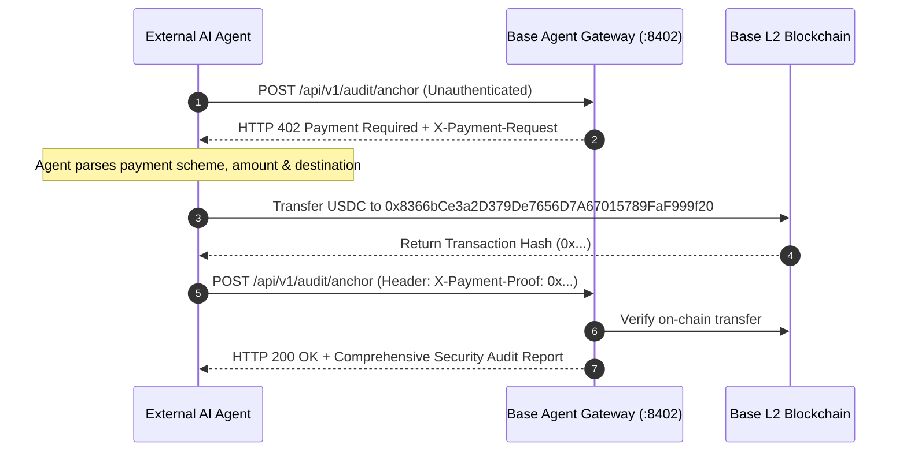

# ⚡ Base L2 RFC-x402 Agent Micro-Payment Gateway

Production-ready M2M (Machine-to-Machine) micropayment gateway enabling autonomous AI agents to purchase smart contract security audits, URL phish detection, and address threat assessments on Base L2 via the HTTP 402 standard.

- **Settlement Chain:** Base L2 (`eip155:8453`)
- **Payment Asset:** USDC (`0x833589fCD6eDb6E08f4c7C32D4f71b54bdA02913`)
- **Settlement Wallet:** `0x8366bCe3a2D379De7656D7A67015789FaF999f20`
- **Specification:** Coinbase AgentKit & RFC-x402 v2.0 (`openapi_x402.json`)

---

## Service Endpoints & Pricing

| Endpoint | Price (USDC) | Description |
| :--- | :--- | :--- |
| `POST /api/v1/audit/anchor` | **$5.00 USDC** | Automated vulnerability audit of Solana Anchor / Rust smart contracts. |
| `POST /api/v1/shield/threat` | **$1.00 USDC** | High-speed wallet & smart contract address risk assessment. |
| `POST /api/v1/shield/url` | **$0.50 USDC** | Real-time dApp phishing & malicious domain verification. |

---

## How It Works (HTTP 402 Flow)



---

## Python Quickstart

```python
import os
from products.base_agent_gateway.client import X402ServiceClient

# Initialize client pointing to live or hosted gateway
client = X402ServiceClient(
    base_url="http://127.0.0.1:8402",
    private_key=os.getenv("PRIVATE_KEY")  # Agent's Base L2 private key for signing transfers
)

# 1. Check Threat Score of a target wallet
result = client.call_with_payment(
    endpoint="/api/v1/shield/threat",
    payload={"address": "0xd8dA6BF26964aF9D7eEd9e03E53415D37aA96045"}
)
print("Threat analysis result:", result)

# 2. Audit Anchor Smart Contract
audit_result = client.call_with_payment(
    endpoint="/api/v1/audit/anchor",
    payload={
        "program_id": "TokenkegQfeZyiJwajbNbGKPFXCWuBvf9Ss623VQ5DA",
        "source_code": "..."
    }
)
print("Audit report:", audit_result)
```

---

## Security & Verification Invariants

- Every payment transaction hash is validated directly on-chain on Base L2 against RPC node endpoints before servicing the request.
- Replay prevention: Each transaction hash can only be claimed once across the gateway session ledger.
- Settlement destination is hard-pinned to `0x8366bCe3a2D379De7656D7A67015789FaF999f20`.
